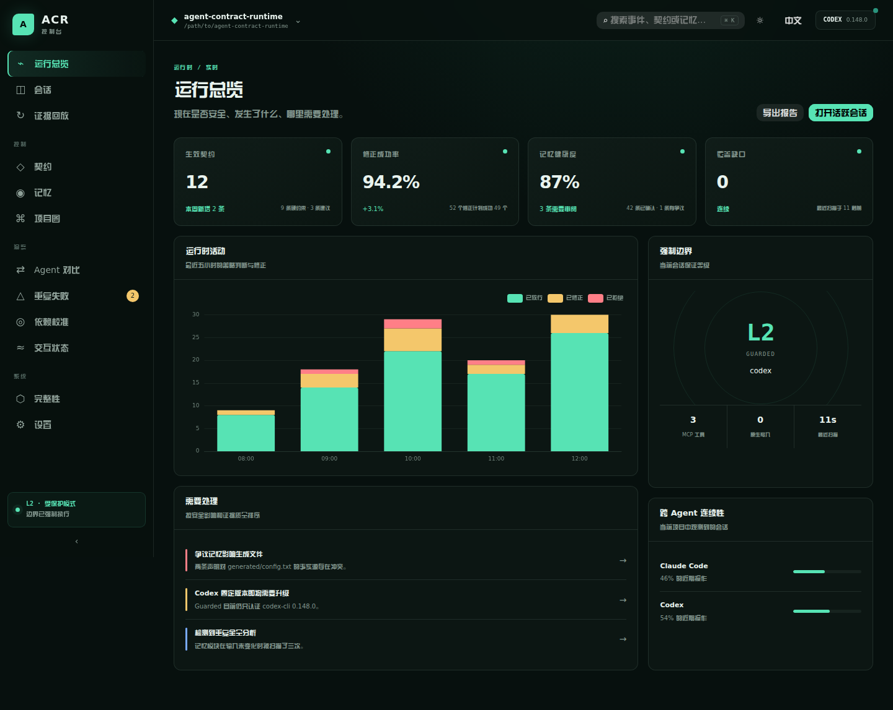
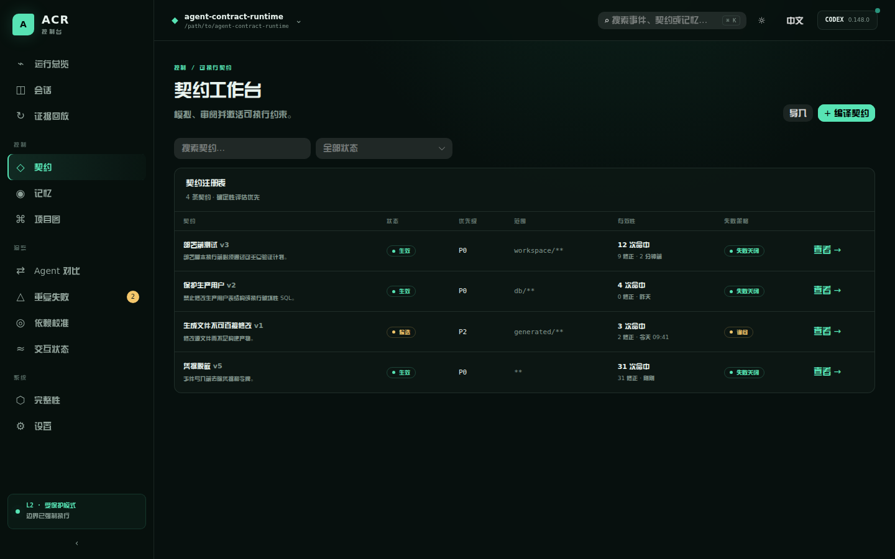
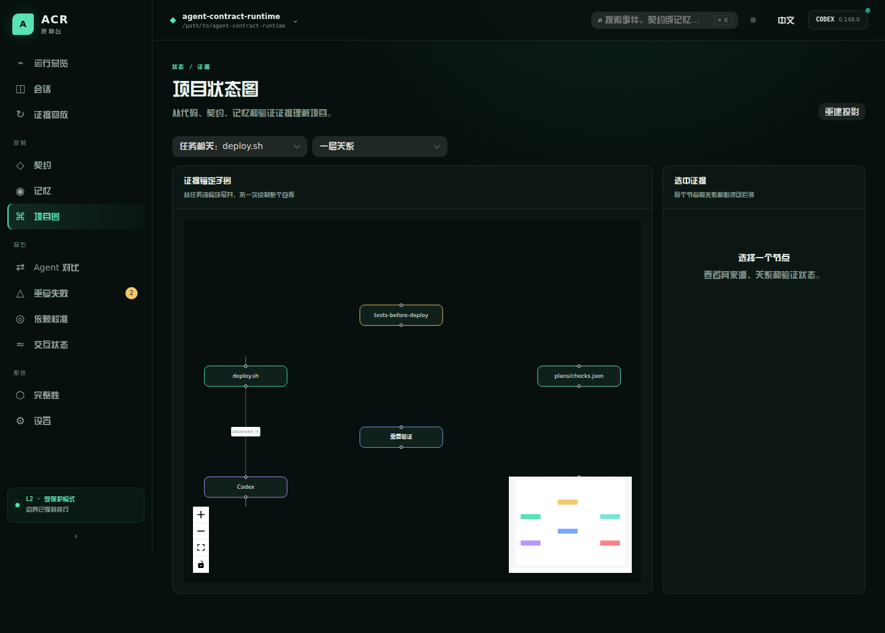
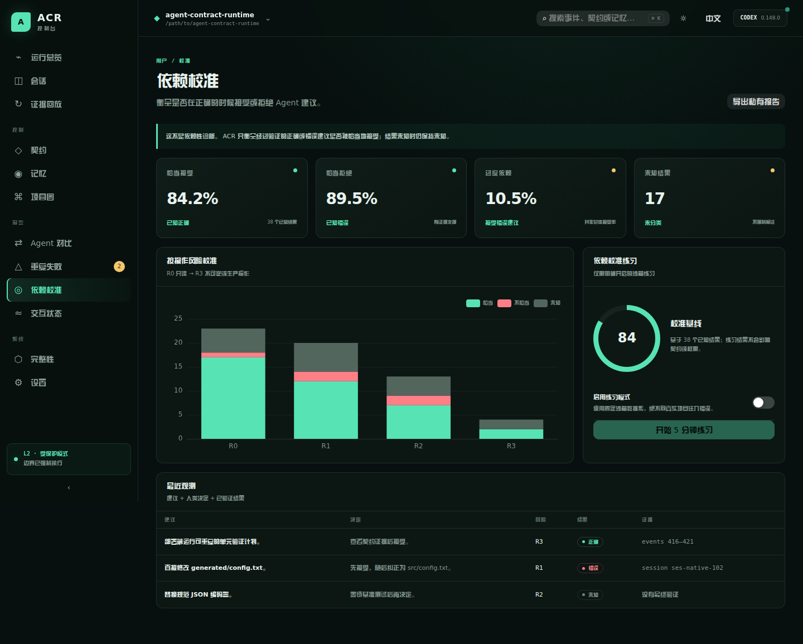

# Agent Contract Runtime (ACR)

[简体中文](README.md) | [English](README_EN.md)

> Cross-agent runtime memory correction.

## Does this sound familiar?

- You said two days ago, “Never modify this database,” but today an AI quietly changes it anyway.
- A project needs several AI coding agents, yet every switch means explaining again what they may and may not touch.
- One agent already implemented and verified a feature, but the next agent analyzes or builds it all over again.
- The agent knows the project rules, but still edits the wrong file, skips the required test, or reaches toward production when tools run.
- You correct a mistake once, but the correction stays inside that conversation and the next session repeats it.

ACR turns project constraints into executable contracts, shares evidence-backed project memory across Claude Code, Codex, and future agents, and decides whether an operation should pass, be rewritten, be repaired, ask for confirmation, or be denied before it runs.

**Explain once, enforce across agents. Correct once, carry it into future sessions. Replay every decision from evidence.**

## What ACR solves

- **Cross-agent continuity** — rules, validated memory, and completed work survive beyond one conversation.
- **Correction before execution** — fix the target or supply missing steps before damage occurs.
- **Executable contracts** — compile constraints such as “never write to production” or “test before deploy” into deterministic rules.
- **Evidence-backed memory** — every memory has provenance, scope, revisions, and a governable lifecycle.
- **Replayable audit trail** — intent, tool input, correction, result, and verification evidence enter an append-only event chain.
- **Project state graph** — expand only the code, contracts, memories, failures, and evidence relevant to the current task.
- **Reliance calibration** — measure whether people appropriately accept correct advice and reject incorrect advice.

## Product tour

### Runtime overview

See contracts, repair success, memory health, coverage gaps, enforcement boundaries, and cross-agent continuity in one place.



### Contract workbench

Inspect, simulate, review, and activate project constraints. A model may create a candidate, but it cannot activate a high-risk contract without human confirmation.



### Project state graph

Explore evidence-anchored relationships between code, contracts, memories, verification plans, agent sessions, and failures without redrawing the whole repository.



### AI reliance calibration

ACR combines recommendation, human decision, and verified outcome to measure appropriate acceptance, appropriate rejection, and over-reliance by action risk. Unknown outcomes stay unknown. This is not a psychological or medical diagnosis, and its optional practice mode uses a fixed sandbox dataset rather than injecting errors into a real project.



## How it works

```text
User constraints / project rules
               │
               ▼
     Executable contracts and memory
               │
               ▼
Agent action ──► PASS / REWRITE / REPAIR / ASK / DENY
               │
               ▼
      Event evidence and state projection
               │
               ▼
Minimal relevant context for the next session or agent
```

ACR is local-first. Deterministic rules and verifiers own the safety boundary. Optional models may propose candidates, summaries, or classifications, but they cannot activate contracts, mutate memory state, or lower runtime permissions.

## Quick start

Go 1.27 or later is required.

```bash
go test ./...
go build -o ./bin/acr ./cmd/acr

# Start the local console
./bin/acr ui --root /path/to/existing-project

# Discover and initialize an existing project
./bin/acr init --root /path/to/existing-project --dry-run
./bin/acr bootstrap sources --root /path/to/existing-project

# Preview Claude Code and Codex hook configuration
./bin/acr install-hooks --root /path/to/existing-project --agent all --dry-run

# Validate the example contracts
./bin/acr contract validate examples/contracts
```

Open `http://127.0.0.1:7480` after starting the console. ACR listens only on loopback, and runtime data stays in the project-local `.acr/` directory by default.

## Decision model

| Decision | Meaning |
| --- | --- |
| `PASS` | The action satisfies every active contract and may run unchanged. |
| `REWRITE` | ACR can deterministically correct the tool input before execution. |
| `REPAIR` | Run a controlled repair or produce missing evidence, then evaluate again. |
| `ASK` | A safe choice cannot be inferred and explicit confirmation is required. |
| `DENY` | The action violates a non-bypassable high-risk constraint. |

## Documentation

- [Architecture](docs/02-architecture.md)
- [Executable contract specification](docs/03-contract-spec.md)
- [Events, state graph, and context model](docs/04-event-and-state-model.md)
- [Security and threat model](docs/07-security-and-threat-model.md)
- [Cross-agent memory lifecycle](docs/08-memory-lifecycle.md)
- [Making ACR do real work](docs/11-practical-runtime.md)
- [Bootstrapping an existing project](docs/12-bootstrap-existing-project.md)
- [Future capabilities](docs/14-future-capabilities.md)

The detailed design documents are currently maintained in Chinese. English documentation will expand as interfaces stabilize.

## Supported agents

- Claude Code: native hooks, session context, before/after tool events, and Guarded mode.
- Codex: tool hooks, an MCP directive channel, session context, and Guarded mode.

Native hooks provide observation and pre-operation decisions. Guarded mode provides a stronger boundary through controlled tool channels. ACR does not claim an absolute boundary against a local machine administrator.

## Privacy and security

- Local storage by default; no cloud synchronization is required.
- Events, exports, and repair output pass through redaction before persistence.
- Model output can create candidates only and cannot elevate permissions.
- Project sequences and a SHA-256 hash chain provide verifiable tamper evidence.
- The console accepts loopback access only and uses a local session token.

## License

Apache License 2.0. See [LICENSE](LICENSE), [CONTRIBUTING.md](CONTRIBUTING.md), and [SECURITY.md](SECURITY.md).
